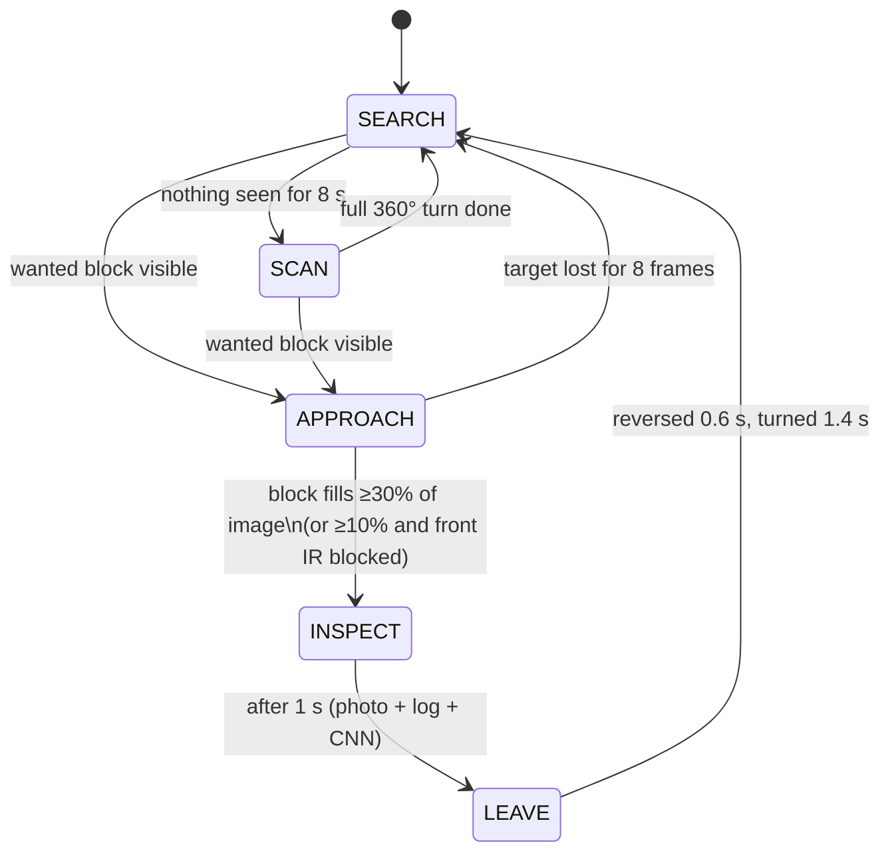

# Colour-Block Search and CNN Classification with an e-puck (Webots)

An e-puck robot searches a 3 × 3 m arena for **red, green and blue blocks** at random positions.
It detects them with **OpenCV HSV colour segmentation**, steers towards each one, stops, photographs it, and optionally classifies the photo with a **CIFAR-10 CNN**.
The CNN runs on a background thread, so it never slows down driving.

Tested with **Webots R2025a**, Python 3.12–3.14, OpenCV 4.x on macOS.

## Folder layout

```
webots_project/
├── worlds/
│   ├── colour_blocks.wbt               # main demo: arena + 3 blocks (random positions) + e-puck
│   ├── colour_blocks_distractors.wbt   # same + a red ball, green cylinder, blue ball (shape CNN test)
│   ├── cnn_camera_test.wbt             # e-puck facing a dog (CIFAR-10 class) for the CNN camera test
│   ├── shape_dataset.wbt               # dataset world: blocks, balls, cylinders in random colours
│   ├── animal_safari.wbt               # all 8 Webots animals, photographed by a supervisor e-puck
│   └── cnn_objects.wbt                 # demo: e-puck tours blocks and CIFAR-10 objects with a checklist
├── controllers/
│   ├── colour_detector/
│   │   ├── colour_detector.py   # robot controller: state machine, motors, sensors, logging
│   │   ├── vision.py            # OpenCV detection (pure functions, unit-tested)
│   │   ├── classifier.py        # CNN inference on background threads (CIFAR-10 + shape model)
│   │   ├── benchmark.py         # opt-in timing experiment (controllerArgs)
│   │   ├── models/              # cifar10_cnn_int8.tflite and webots_shapes_int8.tflite
│   │   └── images/              # created at run time: snapshots + encounters.csv
│   ├── block_randomiser/
│   │   └── block_randomiser.py  # supervisor: random, non-overlapping block (and distractor) positions
│   ├── shape_dataset_collector/
│   │   ├── shape_dataset_collector.py  # supervisor: builds the auto-labelled shape dataset
│   │   └── projection.py               # pinhole projection of known objects into the camera image
│   ├── demo_recorder/
│   │   └── demo_recorder.py     # supervisor: demo video with live captions + ground truth for scoring
│   └── animal_photographer/
│       ├── animal_photographer.py  # supervisor: photographs each animal from 24 directions
│       └── silhouette.py           # background subtraction: the animal's mask and box
└── tests/                       # 62 unit tests, no Webots needed
    ├── test_vision.py           # detector + classifier
    ├── test_benchmark.py        # timing experiment
    ├── test_projection.py       # dataset labelling maths + shape model hook
    └── test_silhouette.py       # animal background subtraction
```

The training notebooks are `../cnn/cifar10_cnn.ipynb` (CIFAR-10) and `../cnn/webots_shapes.ipynb` (the shape model trained on Webots images).

## Setup

1. Install the Python packages for the Python that Webots uses (*Webots → Preferences → Python command*):
   ```bash
   python3 -m pip install opencv-python numpy
   ```
2. **Optional, to turn the CNN on:** run the notebook, then copy `outputs/cifar10_cnn_int8.tflite` into `controllers/colour_detector/models/`.
   Install a TFLite runtime. Either of these works:
   ```bash
   python3 -m pip install ai-edge-litert
   ```
   ```bash
   python3 -m pip install tensorflow
   ```
   Without a model or runtime the robot still works. It prints `CNN OFF - <reason>` at start-up.
3. Open `worlds/colour_blocks.wbt` in Webots and press ▶.

## What you will see in the console

(Excerpt from a real run. CNN labels depend on your trained model.)

```
[randomiser] RED_BLOCK    -> x=+0.87 m, y=+1.03 m
[init] camera 52x39, CNN ON - cifar10_cnn_int8.tflite (TFLiteBackend)
[fsm]    0.06s  SEARCH -> APPROACH (red)
[found] RED block at 23.6s (fills 30% of the image)
[capture] saved red_block_002.png
[cnn] red_block_002: <label> (<confidence>)  top-3: ...  [0.2 ms, off the control loop]
[found] round 1 complete: all colours found in 82.1s - starting a new round
SUMMARY at 82.1s simulated time
  blocks found : red x1, green x1, blue x1
  vision cost  : 0.08 ms per frame over 937 frames
```

Every encounter and CNN prediction is also written to `images/encounters.csv`. For each capture the controller saves:
* `*.png`: the raw camera frame
* `*_annotated.png`: the frame with detection boxes
* `*_cnn_input.png`: the 32 × 32 crop sent to the CNN

**Press C** (click the 3D view first) to capture and classify the current frame at any time.

## How it works

### Behaviour: finite-state machine



| State | What it does |
|---|---|
| SEARCH | Drives forward with IR obstacle avoidance. |
| SCAN | Turns 360° on the spot to look around when nothing has been seen for a while. |
| APPROACH | **Proportional steering**: the wheel speed difference is proportional to how far the block's centroid is from the image centre. It slows down when the block is off to the side. |
| INSPECT | Stops, saves images, logs the candidate and sends the crop to both CNNs. After 1 s it decides: if the shape CNN is at least 60% sure the object is a ball, cylinder or background it is **not counted** (the robot keeps searching and avoids that colour for longer); otherwise the block is confirmed. Without the shape model the HSV result stands. `--shape-check=off` in `controllerArgs` gives the colour-only behaviour. |
| LEAVE | Reverses (stopping early if the rear sensors ps3/ps4 see something) and turns away. That colour is then ignored until all three colours have been found ("rounds"), plus a 12 s cooldown, so the robot goes looking for the *other* blocks instead of revisiting the nearest one. |

### Vision: HSV colour segmentation (`vision.py`)

Each frame goes through these steps:

1. Convert the BGRA frame to BGR.
2. Apply a 3 × 3 Gaussian blur.
3. Convert to HSV.
4. Build one `inRange` mask per colour.
5. Apply a morphological opening, which removes speckle noise.
6. Take the largest external contour, then its area, centroid and bounding box.

| Colour | H (0–179) | S min | V min | Why these limits |
|---|---|---|---|---|
| Red | 0–10 **and** 170–179 | 120 | 40 | Red hue wraps around 0°, so it needs two ranges. V ≥ 40 keeps the shaded face of the block. |
| Green | 45–85 | 120 | 40 | Starts at 45 so the course world's yellow-green grass (H ≈ 36) is **not** detected. |
| Blue | 105–130 | 150 | 40 | Starts at 105 to exclude cyan water (H ≈ 97). S ≥ 150 excludes the grey-blue sky (S ≈ 120). |

A blob must cover at least **0.4% of the image** (about 8 pixels at 52 × 39). The original controller checked only the **centre pixel** in RGB.
That missed any block that was not exactly centred, and RGB thresholds break under shading; the course slides show the RGB filter "blacking out" the red box.

### Bugs fixed from the original `opencv.py`

| Original behaviour | Problem | Fix |
|---|---|---|
| `continue` while red is in the centre | The robot stopped **forever** in front of a red block (deadlock) | INSPECT → LEAVE states |
| Single centre-pixel RGB test | Blocks were missed unless perfectly centred; sensitive to lighting | HSV mask + contours over the whole image |
| Red only | The brief asks for coloured objects | Red, green and blue |
| Obstacle check every 0.5 s | The robot could hit walls between checks | Checked every 32 ms step |
| Saved JPEG | Compression artefacts change the colours | Lossless PNG |
| No summary or log | Results were hard to evaluate | Console summary + `encounters.csv` |

### Optimisation: keeping the robot responsive

* **Background-thread CNN** with a one-slot queue (latest frame wins). The control loop never waits for inference.
* **Event-triggered inference.** The cheap HSV detector (about 0.08 ms per frame, measured) acts as a pre-filter. The CNN only runs at a block, on key C, or at start-up.
* **Lower camera rate.** The camera is enabled at 64 ms, not 32 ms, and vision runs on every second step, which halves the rendering and processing cost.
* **ROI crop.** The detector's bounding box gives a square crop around the object, then a resize to 32 × 32.
* **int8 TFLite model.** It is about 4× smaller than float32, and the accuracy, size and latency trade-off is measured in the notebook (Section 9).

## Hardware notes (e-puck in Webots)

| Device | Name in code | Notes |
|---|---|---|
| Wheel motors | `left wheel motor`, `right wheel motor` | Velocity control (`setPosition(inf)`), max 6.28 rad/s; wheel radius 20.5 mm, axle 52 mm |
| IR proximity | `ps0` … `ps7` | ps0/ps1 front-right, ps7/ps6 front-left. Idle reading about 60–70; > 80 means an obstacle within a few cm. |
| Camera | `camera` | 52 × 39 RGB by default, about 0.84 rad horizontal field of view. `cnn_camera_test.wbt` raises it to 160 × 120 for a sharper CNN test image. |

**Blocks:** `Solid` boxes, **0.3 × 0.3 × 0.1 m**, mass 2 kg with a box bounding object, so they are physical, collide and can be pushed.
The `block_randomiser` supervisor places them at random at start-up. Each block is at least 0.7 m from every other block, 0.6 m from the robot and clear of the walls.
To repeat a layout, put a seed such as `42` in the randomiser Robot node's `controllerArgs`.

## Verified results

These were measured in Webots R2025a, headless, on Apple M4:

* **Search reliability:** with fixed seeds 1–5 for the block layout, the robot found all three colours in **5 of 5 layouts**, taking 42.5, 85.6, 90.9, 70.7 and 46.7 s of simulated time.
* **Vision cost:** about 0.08 ms per 52×39 frame.
* **CNN in the loop:** the int8 TFLite model ran in 0.2–0.3 ms per image on the background thread, with no effect on the 32 ms control step.
* **Shape check against distractors** (`colour_blocks_distractors.wbt`, 5 layouts × 300 s): with `--shape-check=off` the robot counted all 28 distractors it inspected (a red ball, green cylinder, blue ball) as blocks and announced a wrong "all found" in 4 of 5 layouts. With the shape check it rejected all 26 it met, wrongly rejected one real block (a very close, off-centre view), and every "all found" it announced was correct. It is slower (147 s mean to a correct first round) and in one layout did not find the red block within 300 s. Data: `../cnn/results/webots_runs/distractors/`.
* **Timing experiment** (seed 1, 90 s, 2,813 control steps): with 50 ms added to every inference to emulate a slow embedded CPU, running the CNN *inside* the control step on every frame missed the 32 ms deadline in **1,406 steps (50%)**, worst step 135 ms. The deployed design (background thread, event-triggered) missed **0**. Results, figure and the script to re-run it: `../cnn/results/webots_runs/timing/`.
* **CNN model:** 86.47% test accuracy on the 10,000 CIFAR-10 test images (Keras float32); the deployed full-int8 TFLite model scores 86.57% at 328 kB (3.7× smaller than float32). Full numbers: `../cnn/results/`.
* **CNN on Webots camera images:** in `cnn_camera_test.wbt` the dog was classified as **horse (95%)**, with dog third (1%). The blocks are classified mostly as airplane or ship, because a coloured box is not a CIFAR-10 class. Both are out-of-distribution results, discussed in the report. Logs and images: `../cnn/results/webots_runs/`.
* **Every Webots animal** (`animal_safari.wbt`, 8 animals × 24 directions, 192 images labelled by background subtraction): deer and horse were named correctly in 43 of 48 views, cat and dog in none (both mostly "horse"). With the background replaced by grey, the dog was right in 12 of 24 views and the deer dropped from 21 to 4: the CNN leans on the scenery. Re-run with Webots (`--batch` on `worlds/animal_safari.wbt` writes `../cnn/webots_animals/`), then `../cnn/webots_animals.ipynb`. Results: `../cnn/results/webots_animals/`.
* **CNN object tour** (`cnn_objects.wbt`, controller `object_finder`, separate demo): the e-puck drives to three blocks and five real-size Webots objects (truck, horse, car, deer, paper boat), checks blocks with HSV and names objects with the int8 CNN over three photos each. Result: 4 of 5 objects and 3 of 3 blocks; the paper boat is called "airplane". The robot reads object positions as a map; recognition is from the camera only. Photos and CNN answers: `../cnn/webots_object_tour.ipynb`.

## Tests

```bash
python3 -m pip install pytest
```
```bash
python3 -m pytest tests -q
```

The tests check every colour, the shaded red face, and that grass, water, sky and grey floor are **not** detected.
They also check noise rejection, steering offset signs, camera-buffer conversion, square cropping, the CNN preprocessing format, and the background CNN thread: results, error reporting, auto-disable after repeated failures, and a missing model.
`test_benchmark.py` checks the timing experiment: argument parsing and rejection of bad values, the deadline statistics, the emulated latency and synchronous inference.

## Timing experiment (optional)

Normal runs are unaffected. To measure whether CNN inference delays the control loop, put options in the e-puck's `controllerArgs`, for example:

```
--cnn-mode=sync --cnn-trigger=every-frame --emulate-ms=50 --stop-after=90
```

| Option | Meaning |
|---|---|
| `--cnn-mode=async\|sync` | Background thread (default) or inside the control step |
| `--cnn-trigger=event\|every-frame` | Only at blocks, key C and start-up (default), or every processed frame |
| `--emulate-ms=N` | Add N ms to each inference to emulate a slow embedded CPU |
| `--stop-after=S` | Stop after S simulated seconds and write `images/step_timing.json` |
| `--shape-check=on\|off` | Not a timing option: off ignores the shape CNN (colour-only behaviour, for comparison) |

The report gives each step's compute time, the 99th-percentile and worst step, and how many steps exceeded 32 ms.

## Troubleshooting

| Symptom | Fix |
|---|---|
| `ModuleNotFoundError: cv2` | Install opencv-python for the Python shown in Webots' console (`Starting controller: …/python3`). |
| `CNN OFF - no model file` | Copy `cifar10_cnn_int8.tflite` into `controllers/colour_detector/models/`. |
| `CNN OFF - could not load a model -> … ImportError` | Install `ai-edge-litert` or `tensorflow`. |
| Robot ignores a block | It may be on cooldown or already found this round; watch the `[fsm]` lines. |
| Different lighting or colours | Tune `HSV_RANGES` in `vision.py`. The `*_annotated.png` files show what was detected. |
