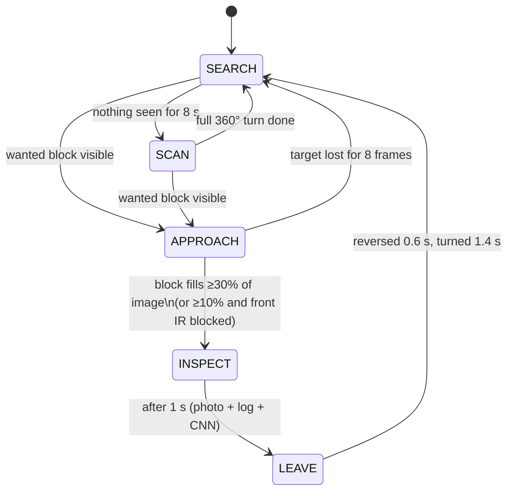

# Colour-Block Search and CNN Classification with an e-puck (Webots)

An e-puck robot searches a 3 × 3 m arena for **red, green and blue blocks** at random positions.
It detects them with **OpenCV HSV colour segmentation**, steers towards each one, stops, photographs it, and optionally classifies the photo with a **CIFAR-10 CNN**.
The CNN runs on a background thread, so it never slows down driving.

Tested with **Webots R2025a**, Python 3.12–3.14, OpenCV 4.x on macOS.

## Folder layout

```
webots_project/
├── worlds/
│   ├── colour_blocks.wbt        # main demo: arena + 3 blocks (random positions) + e-puck
│   └── cnn_camera_test.wbt      # e-puck facing a dog (CIFAR-10 class) for the CNN camera test
├── controllers/
│   ├── colour_detector/
│   │   ├── colour_detector.py   # robot controller: state machine, motors, sensors, logging
│   │   ├── vision.py            # OpenCV detection (pure functions, unit-tested)
│   │   ├── classifier.py        # optional CNN inference on a background thread
│   │   ├── models/              # put cifar10_cnn_int8.tflite here (from the notebook)
│   │   └── images/              # created at run time: snapshots + encounters.csv
│   └── block_randomiser/
│       └── block_randomiser.py  # supervisor: random, non-overlapping block positions
└── tests/
    └── test_vision.py           # 23 unit tests, no Webots needed
```

The training notebook is `../cnn/cifar10_cnn.ipynb`.

## Setup

1. Install the Python packages for the Python that Webots uses (*Webots → Preferences → Python command*):
   ```bash
   python3 -m pip install opencv-python numpy
   ```
2. **Optional, to turn the CNN on:** run the notebook, then copy `outputs/cifar10_cnn_int8.tflite` into `controllers/colour_detector/models/`.
   Install a TFLite runtime. Either of these works:
   ```bash
   python3 -m pip install ai-edge-litert
   ```
   ```bash
   python3 -m pip install tensorflow
   ```
   Without a model or runtime the robot still works. It prints `CNN OFF - <reason>` at start-up.
3. Open `worlds/colour_blocks.wbt` in Webots and press ▶.

## What you will see in the console

(Excerpt from a real run. CNN labels depend on your trained model.)

```
[randomiser] RED_BLOCK    -> x=+0.87 m, y=+1.03 m
[init] camera 52x39, CNN ON - cifar10_cnn_int8.tflite (TFLiteBackend)
[fsm]    0.06s  SEARCH -> APPROACH (red)
[found] RED block at 23.6s (fills 30% of the image)
[capture] saved red_block_002.png
[cnn] red_block_002: <label> (<confidence>)  top-3: ...  [0.2 ms, off the control loop]
[found] round 1 complete: all colours found in 82.1s - starting a new round
SUMMARY at 82.1s simulated time
  blocks found : red x1, green x1, blue x1
  vision cost  : 0.08 ms per frame over 937 frames
```

Every encounter and CNN prediction is also written to `images/encounters.csv`. For each capture the controller saves:
* `*.png`: the raw camera frame
* `*_annotated.png`: the frame with detection boxes
* `*_cnn_input.png`: the 32 × 32 crop sent to the CNN

**Press C** (click the 3D view first) to capture and classify the current frame at any time.

## How it works

### Behaviour: finite-state machine



| State | What it does |
|---|---|
| SEARCH | Drives forward with IR obstacle avoidance. |
| SCAN | Turns 360° on the spot to look around when nothing has been seen for a while. |
| APPROACH | **Proportional steering**: the wheel speed difference is proportional to how far the block's centroid is from the image centre. It slows down when the block is off to the side. |
| INSPECT | Stops, saves images, logs the encounter, sends the crop to the CNN. |
| LEAVE | Reverses (stopping early if the rear sensors ps3/ps4 see something) and turns away. That colour is then ignored until all three colours have been found ("rounds"), plus a 12 s cooldown, so the robot goes looking for the *other* blocks instead of revisiting the nearest one. |

### Vision: HSV colour segmentation (`vision.py`)

Each frame goes through these steps:

1. Convert the BGRA frame to BGR.
2. Apply a 3 × 3 Gaussian blur.
3. Convert to HSV.
4. Build one `inRange` mask per colour.
5. Apply a morphological opening, which removes speckle noise.
6. Take the largest external contour, then its area, centroid and bounding box.

| Colour | H (0–179) | S min | V min | Why these limits |
|---|---|---|---|---|
| Red | 0–10 **and** 170–179 | 120 | 40 | Red hue wraps around 0°, so it needs two ranges. V ≥ 40 keeps the shaded face of the block. |
| Green | 45–85 | 120 | 40 | Starts at 45 so the course world's yellow-green grass (H ≈ 36) is **not** detected. |
| Blue | 105–130 | 150 | 40 | Starts at 105 to exclude cyan water (H ≈ 97). S ≥ 150 excludes the grey-blue sky (S ≈ 120). |

A blob must cover at least **0.4% of the image** (about 8 pixels at 52 × 39). The original controller checked only the **centre pixel** in RGB.
That missed any block that was not exactly centred, and RGB thresholds break under shading; the course slides show the RGB filter "blacking out" the red box.

### Bugs fixed from the original `opencv.py`

| Original behaviour | Problem | Fix |
|---|---|---|
| `continue` while red is in the centre | The robot stopped **forever** in front of a red block (deadlock) | INSPECT → LEAVE states |
| Single centre-pixel RGB test | Blocks were missed unless perfectly centred; sensitive to lighting | HSV mask + contours over the whole image |
| Red only | The brief asks for coloured objects | Red, green and blue |
| Obstacle check every 0.5 s | The robot could hit walls between checks | Checked every 32 ms step |
| Saved JPEG | Compression artefacts change the colours | Lossless PNG |
| No summary or log | Results were hard to evaluate | Console summary + `encounters.csv` |

### Optimisation: keeping the robot responsive

* **Background-thread CNN** with a one-slot queue (latest frame wins). The control loop never waits for inference.
* **Event-triggered inference.** The cheap HSV detector (about 0.08 ms per frame, measured) acts as a pre-filter. The CNN only runs at a block, on key C, or at start-up.
* **Lower camera rate.** The camera is enabled at 64 ms, not 32 ms, and vision runs on every second step, which halves the rendering and processing cost.
* **ROI crop.** The detector's bounding box gives a square crop around the object, then a resize to 32 × 32.
* **int8 TFLite model.** It is about 4× smaller than float32, and the accuracy, size and latency trade-off is measured in the notebook (Section 9).

## Hardware notes (e-puck in Webots)

| Device | Name in code | Notes |
|---|---|---|
| Wheel motors | `left wheel motor`, `right wheel motor` | Velocity control (`setPosition(inf)`), max 6.28 rad/s; wheel radius 20.5 mm, axle 52 mm |
| IR proximity | `ps0` … `ps7` | ps0/ps1 front-right, ps7/ps6 front-left. Idle reading about 60–70; > 80 means an obstacle within a few cm. |
| Camera | `camera` | 52 × 39 RGB by default, about 0.84 rad horizontal field of view. `cnn_camera_test.wbt` raises it to 160 × 120 for a sharper CNN test image. |

**Blocks:** `Solid` boxes, **0.3 × 0.3 × 0.1 m**, mass 2 kg with a box bounding object, so they are physical, collide and can be pushed.
The `block_randomiser` supervisor places them at random at start-up. Each block is at least 0.7 m from every other block, 0.6 m from the robot and clear of the walls.
To repeat a layout, put a seed such as `42` in the randomiser Robot node's `controllerArgs`.

## Verified results

These were measured in Webots R2025a, headless, on Apple M4:

* **Search reliability:** with fixed seeds 1–5 for the block layout, the robot found all three colours in **5 of 5 layouts**, taking 42.5, 85.6, 90.9, 70.7 and 46.7 s of simulated time.
* **Vision cost:** about 0.08 ms per 52×39 frame.
* **CNN in the loop:** the int8 TFLite model ran in 0.2–0.3 ms per image on the background thread, with no effect on the 32 ms control step.

## Tests

```bash
python3 -m pip install pytest
```
```bash
python3 -m pytest tests -q
```

The tests check every colour, the shaded red face, and that grass, water, sky and grey floor are **not** detected.
They also check noise rejection, steering offset signs, camera-buffer conversion, square cropping, the CNN preprocessing format, and the background CNN thread: results, error reporting, auto-disable after repeated failures, and a missing model.

## Troubleshooting

| Symptom | Fix |
|---|---|
| `ModuleNotFoundError: cv2` | Install opencv-python for the Python shown in Webots' console (`Starting controller: …/python3`). |
| `CNN OFF - no model file` | Copy `cifar10_cnn_int8.tflite` into `controllers/colour_detector/models/`. |
| `CNN OFF - could not load a model -> … ImportError` | Install `ai-edge-litert` or `tensorflow`. |
| Robot ignores a block | It may be on cooldown or already found this round; watch the `[fsm]` lines. |
| Different lighting or colours | Tune `HSV_RANGES` in `vision.py`. The `*_annotated.png` files show what was detected. |
